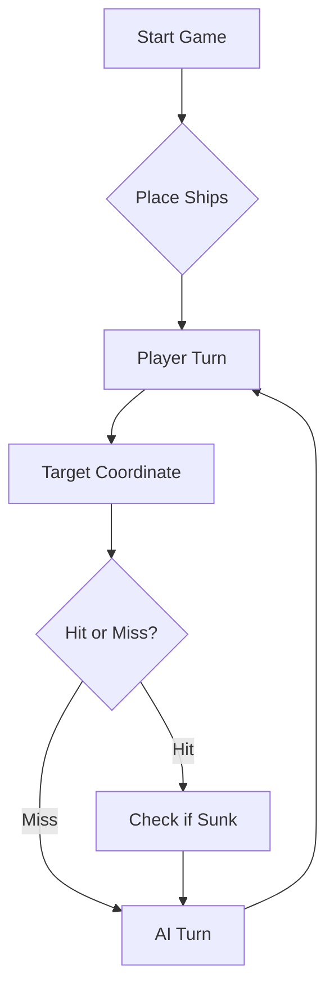

# ⚓ Battleship 2.0


> A modern take on the classic naval warfare game, designed for the XVII century setting with updated software engineering patterns.

---

| Curso | Número | Nome |
| :--- | :--- | :--- |
| LETI | 113146 | Ricardo Oliveira |
| LETI | 129360 | Francisco Farinha |
| LETI | 129763 | Rebeca Noronha |


## 📖 Assignments
- [Prompt Final](#prompt-final)

## PROMPT FINAL

Considere agora a seguinte tática avançada de geração de rajadas de tiros para jogar Batalha Naval dos Descobrimentos como um estratega de elite.

### 1. REGRAS DE MEMÓRIA E REPRESENTAÇÃO VISUAL (DIÁRIO DE BORDO)
- Mantenha um **Diário de Bordo** numerado sequencialmente (Rajada 1, 2, 3...).
- Em CADA turno, desenhe obrigatoriamente o **Mapa Tático 10x10** (linhas A-J, colunas 1-10) usando os seguintes símbolos:
  - `.` : Quadrícula desconhecida (disponível para disparo)
  - `~` : Água confirmada ou Halo de exclusão confirmado
  - `?` : Tiro de uma rajada com acerto ainda não isolado (candidato a navio)
  - `X` : Posição confirmada de navio atingido (mas ainda não afundado)
  - `#` : Posição confirmada de navio afundado
- Registe sempre a **Contagem da Frota Inimiga Restante** (Início: 1 Galeão [5-T], 1 Fragata [4], 2 Naus [3], 3 Caravelas [2], 4 Barcas [1]).
- Nunca dispare fora do mapa (A-J, 1-10) nem repita coordenadas já testadas (exceto na última rajada do jogo, apenas se faltarem menos de 3 quadrículas para afundar o último navio inimigo).

### 2. COMO RESOLVER A AMBIGUIDADE DO JSON (ISOLAMENTO DE ALVOS)
Como o JSON de resposta agrupa os resultados dos 3 tiros sem dizer qual coordenada acertou em quê:
- **PROIBIÇÃO DE HALOS CEGOS:** NUNCA marque um halo (`~`) nem diagonais como água à volta de uma coordenada `?` enquanto não tiver 100% de certeza de qual das 3 coordenadas da rajada anterior continha efetivamente o navio!
- **Se `missedShots: 3`:** Marque imediatamente as 3 coordenadas disparadas como água (`~`).
- **Se uma Barca for afundada (`sunkBoats: Barca`) juntamente com 2 tiros na água:** Como não sabe qual dos 3 tiros era a Barca, marque as 3 coordenadas disparadas como testadas (`~`/`#`), mas NÃO bloqueie os vizinhos (halos) dessas 3 coordenadas, pois duas delas eram apenas água e podem ter navios ao lado!
- **MODO DESTRUIÇÃO (Foco num único alvo de cada vez):** Quando uma rajada obtiver acertos em navios não afundados (`hitsOnBoats` > 0):
  1. Não sonde os 3 tiros em paralelo se isso gerar confusão. Escolha **UMA** das coordenadas candidatas (`?`) de cada vez e dispare nos seus vizinhos ortogonais (Norte, Sul, Este, Oeste) na jogada seguinte para confirmar se o navio está ali e descobrir a sua orientação.
  2. Se encontrar mais acertos adjacentes a essa coordenada, confirme-a como `X` e continue a disparar ao longo dessa linha/coluna até o navio aparecer em `sunkBoats`.
  3. Assim que a localização exata das peças de um navio linear (Caravela, Nau ou Fragata) estiver 100% confirmada sem ambiguidade, marque todas as quadrículas adjacentes (halo de 1 posição à volta, incluindo diagonais) como água intransitável (`~`).
  4. **Atenção ao Galeão (forma de T):** Se o JSON indicar `hitsOnBoats` no `"Galeao"`, NÃO descarte as diagonais do tiro inicial, pois as "asas da ponte" formam um T (ocupando posições diagonais ao eixo central do corpo).

### 3. MODO CAÇA (RECONHECIMENTO EM GRELHA DE PARIDADE)
- Quando não houver navios feridos por afundar, dispare de forma espaçada (padrão xadrez, ex: `B2`, `E5`, `H8`), priorizando zonas amplas onde caibam o Galeão (matriz 3x3), a Fragata (4 em linha) e as Naus (3 em linha).
- Se a sua frota for toda afundada, declare a derrota com honra. Se afundar todos os 11 navios inimigos, celebre a vitória com magnanimidade!

---

### EXEMPLOS DE TREINO (FEW-SHOT PROMPTING)

#### Exemplo 1: Todos os tiros na água (Marcação direta)
**Rajada enviada na jogada anterior:**
`[{"row": "B", "column": 2}, {"row": "E", "column": 5}, {"row": "H", "column": 8}]`
**Resposta JSON recebida:**
`{"validShots": 3, "sunkBoats": [], "repeatedShots": 0, "outsideShots": 0, "hitsOnBoats": [], "missedShots": 3}`
**Raciocínio correto no Diário de Bordo:**
- Como `missedShots: 3`, tenho 100% de certeza de que `B2`, `E5` e `H8` são água (`~`). Continuo em Modo Caça em coordenadas livres afastadas.

#### Exemplo 2: 1 Navio atingido e 2 tiros na água (Isolamento de Alvo sem Halo prematuro)
**Rajada enviada na jogada anterior:**
`[{"row": "C", "column": 3}, {"row": "F", "column": 7}, {"row": "I", "column": 2}]`
**Resposta JSON recebida:**
`{"validShots": 3, "sunkBoats": [], "repeatedShots": 0, "outsideShots": 0, "hitsOnBoats": [{"hits": 1, "type": "Fragata"}], "missedShots": 2}`
**Raciocínio correto no Diário de Bordo:**
- Uma das posições (`C3`, `F7` ou `I2`) é uma Fragata; as outras duas são água.
- **Regra Crítica:** Ainda NÃO sei qual das três é a Fragata, logo NÃO marco diagonais nem halos! Marco `C3`, `F7` e `I2` como `?`.
- Na rajada seguinte, concentro os 3 tiros nas posições ortogonais de `C3` (`B3`, `D3`, `C4`) para testar primeiro `C3`. Se obtiver acertos na Fragata, fica provado que a Fragata está em `C3` (e que `F7` e `I2` eram água `~`!). Se der 3 tiros na água (e `C2` também for água), sei que `C3` era água (`~`) e passo a testar `F7`.

#### Exemplo 3: Aplicação de Halo apenas após confirmação exata
**Histórico:** Confirmei isoladamente que uma Caravela estava em `C3` e `C4` porque disparei em `C4` (mais dois tiros em zonas que deram água) e recebi `sunkBoats: [{"count": 1, "type": "Caravela"}]`.
**Raciocínio correto no Diário de Bordo:**
- Como tenho 100% de certeza de que a Caravela ocupa `C3` e `C4`, marco `C3` e `C4` como `#` e bloqueio todo o halo envolvente (`B2, B3, B4, B5, C2, C5, D2, D3, D4, D5`) como água intransitável (`~`).

---
Confirme que compreendeu esta estratégia, inicialize o Diário de Bordo com o Mapa 10x10 limpo e envie a **Rajada 1** em formato JSON.


## 📖 Table of Contents
- [Project Overview](#-project-overview)
- [Key Features](#-key-features)
- [Technical Stack](#-technical-stack)
- [Installation & Setup](#-installation--setup)
- [Code Architecture](#-code-architecture)
- [Roadmap](#-roadmap)
- [Contributing](#-contributing)

---

## 🎯 Project Overview
This project serves as a template and reference for students learning **Object-Oriented Programming (OOP)** and **Software Quality**. It simulates a battleship environment where players must strategically place ships and sink the enemy fleet.

### 🎮 The Rules
The game is played on a grid (typically 10x10). The coordinate system is defined as:

$$(x, y) \in \{0, \dots, 9\} \times \{0, \dots, 9\}$$

Hits are calculated based on the intersection of the shot vector and the ship's bounding box.

---

## ✨ Key Features
| Feature | Description | Status |
| :--- | :--- | :---: |
| **Grid System** | Flexible $N \times N$ board generation. | ✅ |
| **Ship Varieties** | Galleons, Frigates, and Brigantines (XVII Century theme). | ✅ |
| **AI Opponent** | Heuristic-based targeting system. | 🚧 |
| **Network Play** | Socket-based multiplayer. | ❌ |

---

## 🛠 Technical Stack
* **Language:** Java 17
* **Build Tool:** Maven / Gradle
* **Testing:** JUnit 5
* **Logging:** Log4j2

---

## 🚀 Installation & Setup

### Prerequisites
* JDK 17 or higher
* Git

### Step-by-Step
1. **Clone the repository:**
   ```bash
   git clone [https://github.com/britoeabreu/Battleship2.git](https://github.com/britoeabreu/Battleship2.git)
   ```
2. **Navigate to directory:**
   ```bash
   cd Battleship2
   ```
3. **Compile and Run:**
   ```bash
   javac Main.java && java Main
   ```

---

## 📚 Documentation

You can access the generated Javadoc here:

👉 [Battleship2 API Documentation](https://britoeabreu.github.io/Battleship2/)


### Core Logic
```java
public class Ship {
    private String name;
    private int size;
    private boolean isSunk;

    // TODO: Implement damage logic
    public void hit() {
        // Implementation here
    }
}
```

### Design Patterns Used:
- **Strategy Pattern:** For different AI difficulty levels.
- **Observer Pattern:** To update the UI when a ship is hit.
</details>

### Logic Flow


---

## 🗺 Roadmap
- [x] Basic grid implementation
- [x] Ship placement validation
- [ ] Add sound effects (SFX)
- [ ] Implement "Fog of War" mechanic
- [ ] **Multiplayer Integration** (High Priority)

---

## 🧪 Testing
We use high-coverage unit testing to ensure game stability. Run tests using:
```bash
mvn test
```

> [!TIP]
> Use the `-Dtest=ClassName` flag to run specific test suites during development.

---

## 🤝 Contributing
Contributions are what make the open-source community such an amazing place to learn, inspire, and create.

1. Fork the Project
2. Create your Feature Branch (`git checkout -b feature/AmazingFeature`)
3. Commit your Changes (`git commit -m 'Add some AmazingFeature'`)
4. Push to the Branch (`git push origin feature/AmazingFeature`)
5. Open a **Pull Request**

---

## 📄 License
Distributed under the MIT License. See `LICENSE` for more information.

---
**Maintained by:** [@britoeabreu](https://github.com/britoeabreu)  
*Created for the Software Engineering students at ISCTE-IUL.*
